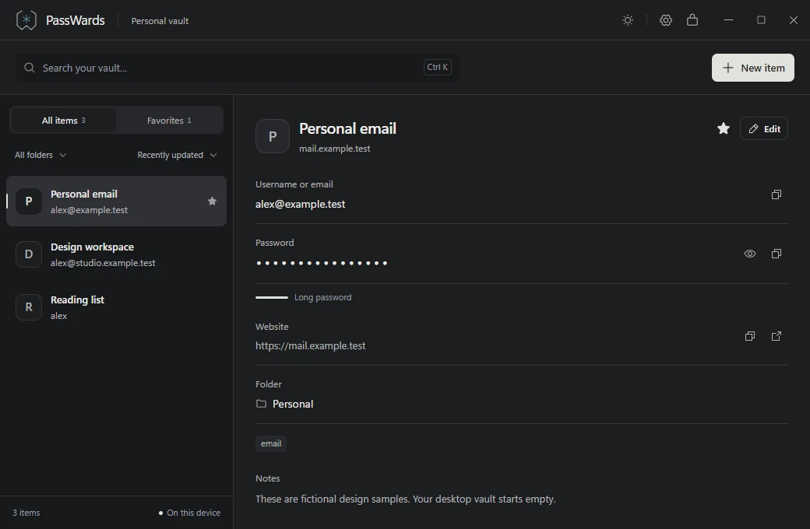

# PassWards

[Download for Windows](https://github.com/MiladClark/Paswords-mannager/releases/latest) · [Documentation](https://devtune.app/docs/passwards) · [Security model](SECURITY.md)



*Actual app interface. The accounts shown are fictional demonstration data.*

A small, offline desktop password vault. English-only for this release; Persian translations and RTL code are preserved behind a disabled feature flag. The default window is a compact 900 × 640. Neutral light and dark themes start from the system preference and can be switched in the header. The native title bar is replaced with integrated drag space and minimize, maximize/restore and close controls.

**Early version, not independently audited. Start with test data. There is no promise of being impenetrable.**

## Use the app

Download the Windows x64 EXE from [GitHub Releases](https://github.com/MiladClark/Paswords-mannager/releases/latest), or extract the portable ZIP and open `PassWards.exe`. There is no installer or automatic updater. The app embeds its frontend and browser extension; use Settings → Browsers to prepare the extension and pair Chrome or Edge. Rust, Node and C++ Build Tools are development requirements only. Windows 10/11 x64 and Microsoft Edge WebView2 Runtime are required to run the app.

1. Create a vault with a unique master passphrase of at least 12 characters. There is no password reset or recovery backdoor.
2. Add an item with a name, username/email, password, website, folder, tags and notes. Additional fields can be visible or hidden.
3. Use the header button to switch themes. The app always starts in English, including when an older Persian preference exists. Only non-secret language/theme preferences are saved in localStorage.
4. Use Settings to save an encrypted `.passward` backup, import a `.passward` or legacy `.nook` backup, or change the master password. Import adds separate copies; it never overwrites existing items. Use a new filename when exporting.
5. Keep an encrypted backup off the device. On a new device, create a vault, then import the backup using the master password that applied when that backup was made. Older backups keep their original passwords and contents, including deleted items.

Items can be starred, searched, sorted and grouped by folder. Deletion is permanent, with no trash: enter the exact phrase `I agree` in both confirmation boxes, then enter the master password again. The action is presented as a trash-can icon; it permanently deletes the record and its history. Canceling either stage leaves the item intact. Legacy trash markers are ignored so existing records remain accessible in the ordinary list. Up to five previous passwords are retained per item. Those versions are encrypted too.

The app locks on minimization, Windows session lock/disconnect/user changes, suspend/resume, and after five minutes of inactivity. Returning to Windows never automatically unlocks the vault. Locking discards unsaved edits. Closing with unsaved edits asks before discarding. Copied fields are cleared after about 30 seconds if the clipboard still contains that value; PassWards never clears an unrelated replacement. Windows clipboard exclusion hints are used to keep copies out of system history/cloud processing. Third-party clipboard managers may not honor these hints.

## Master password only

PIN setup, storage, unlock and item prompts are removed. Unlocking the app uses only the master password; reading and editing inside an unlocked vault do not ask for another credential. Permanent deletion, browser fill approval, backup import and master-password change require the appropriate master password.

Five consecutive incorrect master-password checks start a progressive 1–30 second cooldown across verification actions in the running process. Restarting the app or attacking a stolen file offline bypasses this software limiter. New master passphrases must have at least 12 characters; a small local check rejects obvious common/repeated passwords. No password is sent to a breach-check service.

On a successful master unlock, a legacy device-PIN file or recognized interrupted PIN temporary file triggers an atomic data-key rotation before those old files are removed. No old PIN is requested or supported. Migration preserves records. Copies of old vaults/backups cannot be remotely revoked; keep the master password that applied to each backup.

Automatic backups are **off by default**. Settings can enable verified encrypted snapshots in the app-data automatic-backups/ directory. On changes, up to seven recent snapshots are kept, at most every 15 minutes while unlocked; enabling it creates one immediately. Verification authenticates every record and checks SQLite integrity. Backup work never refreshes the inactivity timer. Old snapshots may retain deleted items; local backups do not protect against loss of the whole device. Disabling automatic snapshots leaves existing ones intact. Use Import backup to recover a snapshot with the master password that applied when it was created.

Keyboard shortcuts: `Ctrl N` new item, `Ctrl K` search, `Ctrl S` save edits, `Ctrl Shift L` lock. Every shortcut also has a visible control.

There is no artificial item-count limit. Available storage, memory and hardware set the practical limit. Lists return 50 items per page; names and other search metadata are indexed in Rust memory while unlocked. Unlocking authenticates and indexes every record, and search scans that in-memory index. The core tests exercise a 10,000-item vault; this is not a claim of infinite scale.

The live database is in the per-user Tauri application-data directory, normally `%APPDATA%\com.parag.nook\vault.sqlite3` on Windows. The identifier and encryption format retain their old name for compatibility. Do not edit it by hand or replace an active database. The app enforces a single running instance.

## Chrome, Edge and Brave

Version 0.3 includes the Manifest V3 extension in `browser-extension/`. Load that folder with Developer mode → Load unpacked in `chrome://extensions`, `edge://extensions` or `brave://extensions`. It is not published to an extension store yet.

Open PassWards, then Settings → Browsers to prepare the extension. Opening the extension popup automatically connects that browser profile without a manual code. Filling and saving still require desktop approval. If you move the executable, use Repair connection in that copy of the app.

Open a login page, select a matching account and choose Fill. Approve the domain/account in the desktop app with the master password. Only that account is released, once, within a 90-second request window. The extension fills visible fields; automatic sign-in is off by default and can be enabled in Autofill settings for valid same-origin POST forms. After the browser grants the required HTTP/HTTPS site access once, login forms are detected automatically. On a focused login page the toolbar popup opens once; if the browser blocks it, an inline account picker appears beside the form. Dynamic forms are detected too. Arrow keys and Enter select an account; Escape closes the menu. The popup can search matching accounts. Pairing persists across browser/app restarts; only Settings → Browsers in the desktop app can revoke it.

Submitted logins offer exactly one Save or Update action in the extension popup, followed by a desktop confirmation with the master password. There are no in-page save cards or duplicate manual-save buttons while an offer is pending. The popup is opened once for an automatic offer when the active browser permits it; otherwise its toolbar badge indicates the pending offer. Identical logins do not prompt again. Updates preserve metadata and password history; submissions are not proof that the site accepted the login. When a browser login is saved or updated, its cached site favicon is normalized to a small PNG and encrypted with the entry. Icons appear in the list and details and stay available offline and in backups; missing icons use the name initial. The extension needs the favicon permission to read the browser cache. Captured passwords remain transient in memory, never in extension storage. The popup also offers Save entered login: one click reads the current form and opens the desktop approval request, without submitting the website or requiring another Review click. Capture prioritizes the active modal/form, recognizes revealed passwords and permits explicit reading of temporarily read-only fields; PIN/OTP and cross-origin form destinations remain excluded.

Matching uses the exact scheme, host and port stored in the item's Website. Login iframes, hidden fields, sign-up forms, OTP/PIN inputs and forms with a different-origin action are excluded. Custom site widgets can require manual copying. See [extension setup and supported forms](browser-extension/README.md).

## Develop

Prerequisites: Rust stable MSVC, Microsoft C++ Build Tools with Windows SDK, Node.js, pnpm and WebView2. Open a new terminal after installing Rust so Cargo is on PATH.

Run development commands from the repository root, where `package.json` lives. Frontend source is in `src/`, native Rust code in `src-tauri/`, and the canonical extension source in `browser-extension/`. Dependencies, compiled outputs, test artifacts and release EXEs/ZIPs are ignored by Git. Downloads belong to GitHub Releases, not the source tree.

```powershell
pnpm install
pnpm tauri dev
```

The native app is required for the real vault. Opening `http://localhost:1420` in a normal browser does not expose the Rust bridge. An explicit development-only `?preview=1` route uses fictional in-memory UI fixtures. It never opens the real vault; those fixtures and their adapter are removed from the production bundle.

```powershell
pnpm typecheck
pnpm build
pnpm test:core
pnpm check:core
pnpm test:ui
pnpm build:extension
cargo build --manifest-path src-tauri/Cargo.toml --example browser_fixture
pnpm test:extension
pnpm tauri build --no-bundle
```

UI tests launch an isolated headless Microsoft Edge context with fictional data. They exercise CRUD, two-stage permanent deletion, keyboard actions, unsaved changes, lock-state cleanup, English-only behavior with preserved Persian source, light/dark accessibility, narrow layouts and master-password reauthentication. Core tests cover authenticated encryption, wrong passwords, tampering, persistence, key rotation, rollback, backups, history, pagination, 10,000 records, locked key memory, Windows lock-event handling, legacy PIN retirement, master-password cooldowns and fresh-master deletion. Browser-pairing DPAPI tests must run under a normal Windows user profile.

Extension integration tests launch a fresh Edge or Chrome profile and register a separate temporary `com.passward.fixture` native host. The test-only Rust example uses a temporary fictional vault and a private test pipe; no real vault is opened. The same suite can exercise the release binary's real native-host path by setting `PASSWARD_NATIVE_EXE` to its absolute path. It acquires exclusive ownership of the standard pipe first and fails if a running PassWards 0.3 instance already owns it. Test host registry entries and the isolated profile are removed afterward.

The output is a standalone Windows executable. Run `pnpm package:release` after building to prepare the versioned EXE, portable ZIP and SHA-256 checksums under `release/`. No installer, automatic update client, cloud sync or telemetry is included. The executable is currently unsigned. Development dependency audits run separately from the offline app: `scripts/check-security.ps1` (requires pnpm, Cargo and cargo-audit); CI runs the same checks on pushes and pull requests.

See [SECURITY.md](SECURITY.md) for the security model and its limits, and [ROADMAP.md](ROADMAP.md) for the browser-extension and product development plan.

To test installed Chrome, set `PASSWARD_TEST_CHANNEL=chrome`. The harness uses a new disposable browser profile and never changes the normal browser profile.

## Repository layout

```text
src/                 React app interface
src-tauri/           Rust vault, Windows integration, native browser bridge
browser-extension/   Chrome and Edge extension source
scripts/             Build, checks, and release packaging
tests/               Browser UI tests
assets/              Brand assets and sample screenshot
docs/releases/       Notes for each tagged release
.github/workflows/   Security checks and Windows release pipeline
```

## Publish a version

Update the versions in `package.json`, `src-tauri/tauri.conf.json`, `src-tauri/Cargo.toml` and `src-tauri/Cargo.lock`. Add matching notes in `docs/releases/vX.Y.Z.md`, run the checks, commit, then push the matching `vX.Y.Z` tag. The Release workflow validates the tag, tests the vault, builds the EXE, packages a portable ZIP and publishes both with SHA-256 checksums. It does not create an installer or register a cloud updater.
